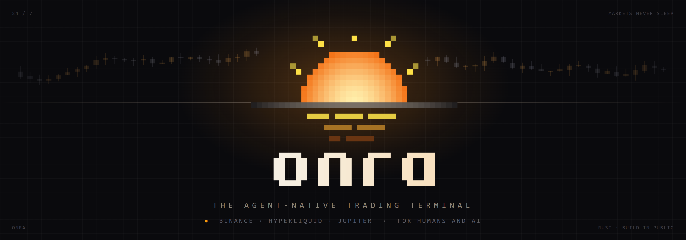
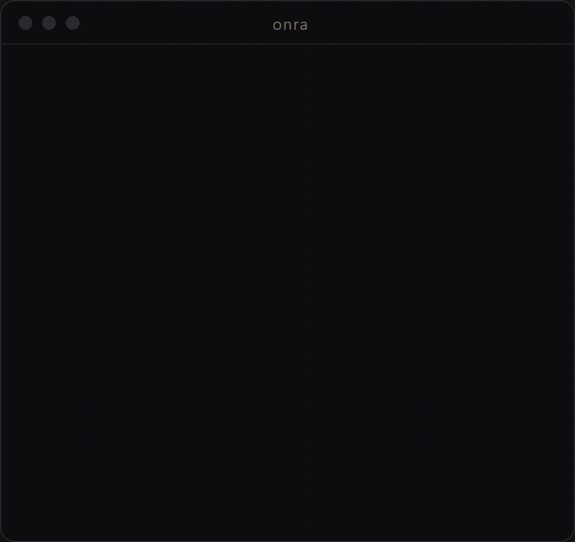
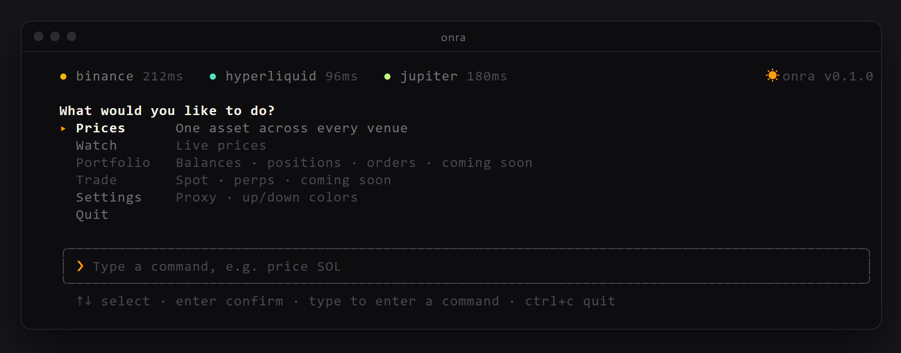
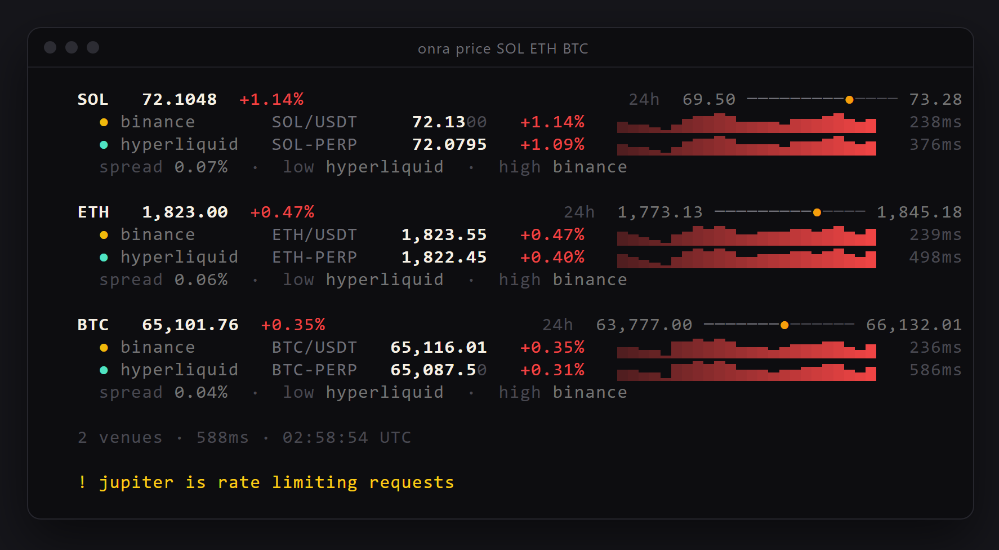
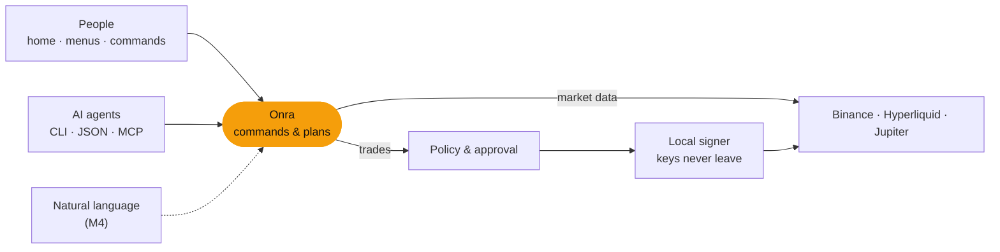

<p align="center">
  
</p>

<p align="center">
  <a href="https://github.com/yu7dan/onra/actions/workflows/ci.yml"></a>
  
  
  <a href="LICENSE"></a>
  <a href="https://x.com/bingjie758"></a>
</p>

<p align="center">
  <b>One command line to every on-chain market, for people and AI agents alike.</b><br>
  <sub>Binance · Hyperliquid · Jupiter today. Accounts, trading and natural language on the way.</sub>
</p>

<p align="center"><a href="README.zh-CN.md">简体中文</a></p>

<p align="center"></p>

---

## Why Onra

AI agents are fluent in the command line. Markets speak a dozen incompatible
APIs. Onra stands between them: one interface that reaches every venue,
styled for the people at the keyboard and precise for the agents behind it.

<table>
<tr>
<td width="33%" valign="top">

### ☀ For people

A home screen, guided menus and an input box with completion and inline
suggestions. Nothing to memorize, and every menu action shows the command
it ran, so the menu teaches the CLI.

</td>
<td width="33%" valign="top">

### ⌁ For agents

Every command speaks stable, versioned JSON: numbers as strings, structured
errors with machine-readable hints, meaningful exit codes, NDJSON streams,
partial results when a venue is down.

</td>
<td width="33%" valign="top">

### ◆ Safety first

Non-custodial. Agents never touch a key. Every trade becomes a plan that is
simulated and checked against your policy before anything is signed.
<sub><i>Trading lands in M3.</i></sub>

</td>
</tr>
</table>

Onra is infrastructure: not an agent, not a strategy, not a bot. It is the
entry point that agents and people use to reach markets.

## A closer look

**The home screen.** `onra` on a terminal opens a session: venue health with
live latency, a menu, and an input box that takes exactly the same commands
as the CLI.

<p align="center"></p>

**Every venue in one view.** `onra price` puts each asset's quotes side by
side: a reference price (the median), the 24h range, sparklines that fade
from past to present, and the spread between the cheapest and the dearest
venue.

<p align="center"></p>

**Live.** `onra watch` streams prices. Moves flash in the up/down color and
fade; each quote draws its own micro-trend for the session.

<p align="center"></p>

## Quick start

```console
$ git clone https://github.com/yu7dan/onra && cd onra
$ cargo build --release            # Rust 1.88+
$ ./target/release/onra            # the interactive home screen
$ ./target/release/onra price SOL ETH
$ ./target/release/onra watch BTC-PERP@hl --interval 0.5
```

Behind a firewall? `onra config set network.proxy http://127.0.0.1:7890`.
`http://`, `https://` and `socks5://` all work.

Up/down colors follow your system locale (Chinese, Japanese and Korean show
gains in red); switch with `onra config set ui.color_convention west`.

## For agents

The same command, piped or called by an agent, answers in JSON:

```console
$ onra price SOL@hl | jq .
{
  "ok": true,
  "data": {
    "assets": [{
      "query": "SOL@hl",
      "reference_price": "71.2175",
      "quotes": [{
        "market": { "venue": "hyperliquid", "symbol": "SOL-PERP", "kind": "perp", ... },
        "price": "71.2175",
        "change_24h_pct": "3.8262",
        "low_24h": "67.504",
        "high_24h": "73.24",
        "trend_24h": ["71.313", "71.327", ...],
        "latency_ms": 632
      }]
    }]
  },
  "meta": { "v": 1, "ts": "2026-11-16T01:33:08Z", "latency_ms": 635 }
}
```

With several venues, each asset also carries `spread_pct`, `lowest` and
`highest`: the cross-venue comparison, precomputed. `onra watch --json`
streams NDJSON (a `snapshot`, then `tick` events); pass `--count N` to stop.

<details>
<summary><b>Errors and exit codes</b></summary>

Errors carry a stable `code`, a `retryable` flag and a `hint`, usually the
next command to run. If one venue fails, the others still answer and the
failure is listed under `warnings`.

| Exit | Meaning |
|---|---|
| 0 | Success (possibly with warnings) |
| 1 | General error (config, internal) |
| 2 | Usage error |
| 3 | Blocked by policy *(M3)* |
| 4 | Needs human approval *(M3)* |
| 5 | Venue error, or market not found |
| 6 | Network error or rate limited, retryable |
| 7 | Plan expired *(M3)* |

</details>

## Markets

One identifier scheme across every venue: `<base>[/<quote>][-PERP][@<venue>]`

| Identifier | Meaning |
|---|---|
| `SOL` | SOL on every venue that lists it |
| `SOL@jup` | SOL spot on Jupiter |
| `ETH-PERP@hl` | ETH perpetual on Hyperliquid |
| `BTC/USDT@bn` | BTC/USDT spot on Binance |
| `<mint>@jup` | A Solana token by mint address |

Bare symbols only resolve to verified tokens. Solana is full of tokens that
impersonate real tickers; unverified ones are reachable by mint address and
are always flagged.

## How it fits together



## Roadmap

| | Milestone | Scope |
|:-:|---|---|
| ✅ | **M0 Foundation** | Output contract, rendering, brand, `price` across three venues |
| ✅ | **M1 Interaction** | Home screen, menus, completion, history · `watch` live prices · `search` with impostor detection |
| ⏳ | **M2 Accounts** | Local keystore, balances, positions, orders, order books |
| ⏳ | **M3 Trading** | Plan → simulate → policy → confirm → execute, signer daemon, audit log |
| ⏳ | **M4 Intelligence** | Natural-language assistant (bring your own model), MCP server, agent identities |
| ⏳ | **M5 Release** | Installers, docs, v0.5 |

## Build in public

Onra is built in the open, one commit at a time. Progress, screenshots and
design notes are posted on X: **[@bingjie758](https://x.com/bingjie758)**.
Ideas and issues are welcome.

## License

[Business Source License 1.1](LICENSE). Free for personal and other
non-commercial use, including trading your own assets and powering your own
agents. Offering Onra or a derivative as a commercial product or service
needs a commercial license. Each version converts to Apache 2.0 four years
after release.
