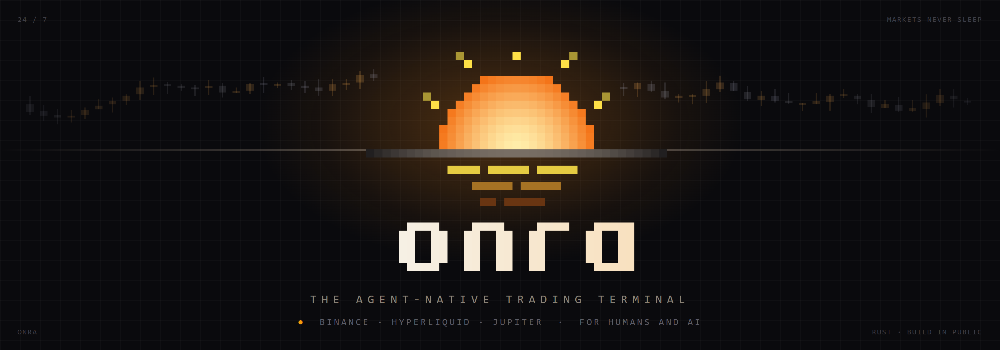
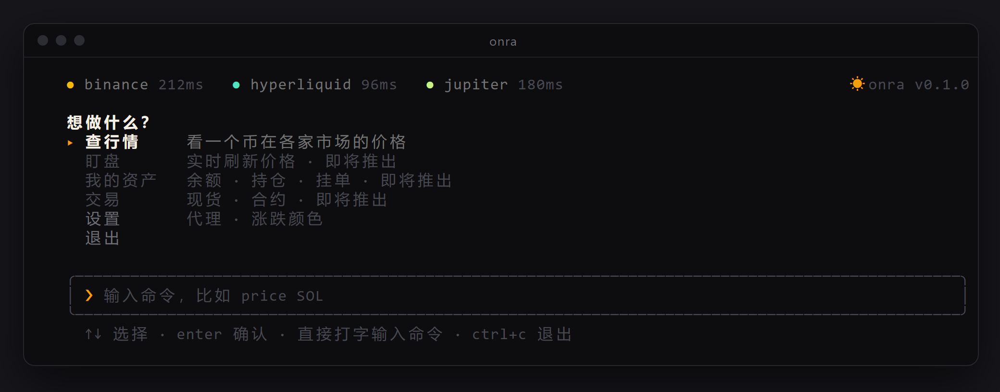
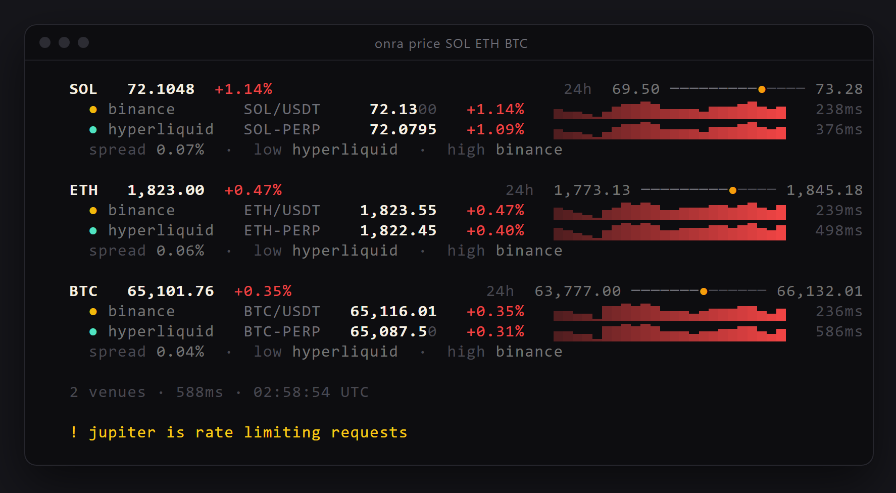
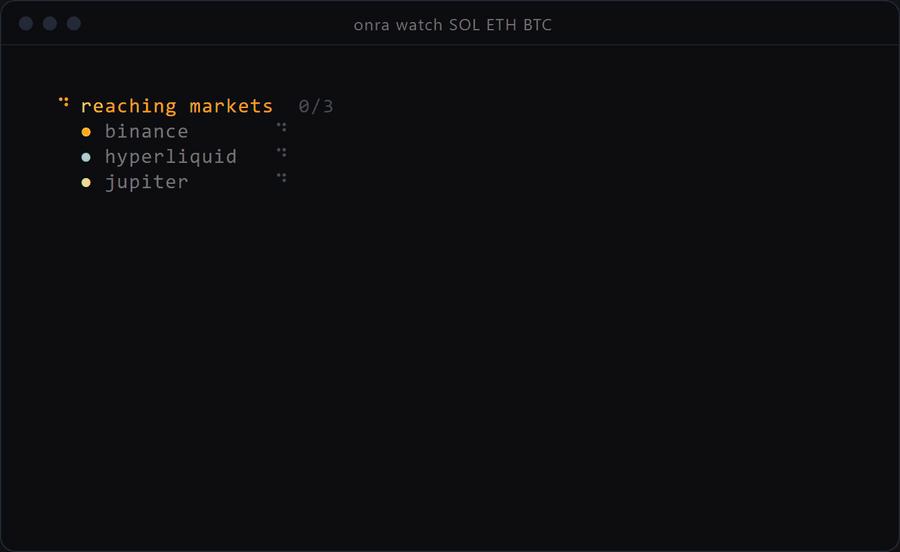

<p align="center">
  
</p>

<p align="center">
  <a href="https://github.com/yu7dan/onra/actions/workflows/ci.yml"></a>
  
  
  <a href="LICENSE"></a>
  <a href="https://x.com/bingjie758"></a>
</p>

<p align="center"><a href="README.md">English</a></p>

AI Agent 最擅长的界面是命令行，而市场的接口各说各话。**Onra** 站在两者之间：一个入口到达所有市场，对键盘前的人足够好看，对背后的 AI 足够精确。现已接入币安、Hyperliquid、Jupiter，账户、交易和自然语言正在路上。

## 为什么是 Onra

<table>
<tr>
<td width="33%" valign="top">

### ☀ 给人用

首页、引导菜单、带补全和联想的输入框。不用背命令；每次通过菜单操作，都会显示对应的命令，菜单本身就是教程。

</td>
<td width="33%" valign="top">

### ⌁ 给 AI 用

每条命令都输出稳定、带版本号的 JSON：数字用字符串、结构化错误附带可执行的提示、有意义的退出码、NDJSON 实时流；某家市场挂了，其他市场照常返回。

</td>
<td width="33%" valign="top">

### ◆ 安全优先

非托管，AI 永远碰不到私钥。每笔交易先生成方案，模拟并通过你的风控规则之后才会签名。
<sub><i>交易功能在 M3 上线。</i></sub>

</td>
</tr>
</table>

Onra 是基础设施：不是 Agent，不是策略，也不是机器人。它是人和 AI 进入市场的那个入口。

## 看看它

**交互首页。** 在终端里直接运行 `onra`：顶部是各市场的连接状态和实时延迟，中间是菜单，下面是输入框，命令和 CLI 完全一致。

<p align="center"></p>

**一屏看遍所有市场。** `onra price` 把同一资产在各家的报价并排：参考价（中位数）、24 小时区间、从过去淡到现在的走势图，以及最便宜和最贵的市场之间的价差。

<p align="center"></p>

**实时。** `onra watch` 实时刷新价格：价格变动时闪一下涨跌色再淡出，每个报价都画出本次盯盘以来的微走势。

<p align="center"></p>

## 快速开始

```console
$ git clone https://github.com/yu7dan/onra && cd onra
$ cargo build --release            # 需要 Rust 1.88+
$ ./target/release/onra            # 交互首页
$ ./target/release/onra price SOL ETH
$ ./target/release/onra watch BTC-PERP@hl --interval 0.5
```

绑定账户后可以查看资产。钱包只需要公开地址；币安用只读 API key（开了提现权限的 key 会被拒绝），存放在系统密钥链里：

```console
$ onra account add hl 0x…
$ onra account add sol <地址>
$ onra account login bn            # 隐藏输入
$ onra portfolio                   # 余额、持仓、挂单
```

网络需要代理？`onra config set network.proxy http://127.0.0.1:7890`，支持 `http://`、`https://` 和 `socks5://`。

涨跌颜色默认跟随系统语言：中文、日文、韩文系统红涨绿跌，可用 `onra config set ui.color_convention west` 切换。

## 给 AI 用

同一条命令，接管道或被 AI 调用时输出 JSON。多个市场时，每个资产还会带上 `spread_pct`、`lowest`、`highest`，跨市场对比已经算好。`onra watch --json` 输出 NDJSON（先一个 `snapshot`，之后是 `tick` 事件），用 `--count N` 控制次数。

错误带有稳定的 `code`、`retryable` 标记和 `hint`（通常是下一步可以执行的命令）。退出码：0 成功 · 1 一般错误 · 2 用法错误 · 3 被风控拦截（M3）· 4 需要人工审批（M3）· 5 市场错误或未找到 · 6 网络错误或被限流，可重试 · 7 方案过期（M3）。

## 市场标识

所有市场统一一种写法：`<base>[/<quote>][-PERP][@<venue>]`

| 写法 | 含义 |
|---|---|
| `SOL` | 所有上架 SOL 的市场 |
| `SOL@jup` | Jupiter 上的 SOL 现货 |
| `ETH-PERP@hl` | Hyperliquid 上的 ETH 永续 |
| `BTC/USDT@bn` | 币安上的 BTC/USDT 现货 |
| `<mint>@jup` | 用合约地址指定 Solana 代币 |

只写代码时只会匹配已验证的代币。Solana 上有大量冒名的代币；未验证的代币必须用合约地址查询，并且一定会被标记。

## 路线图

| | 里程碑 | 内容 |
|:-:|---|---|
| ✅ | **M0 地基** | 输出协议、渲染、品牌、三家市场的 `price` |
| ✅ | **M1 交互** | 首页、菜单、补全、历史 · `watch` 实时盯盘 · `search` 识别仿冒币 |
| 🚧 | **M2 账户** | ✅ 系统密钥链、余额、持仓、挂单、资产打码 · ⏳ 订单簿、资金费率 |
| ⏳ | **M3 交易** | 方案 → 模拟 → 风控 → 确认 → 执行、签名进程、审计日志 |
| ⏳ | **M4 智能** | 自然语言助手（自带模型）、MCP、Agent 身份 |
| ⏳ | **M5 发布** | 安装包、文档、v0.5 |

## 公开构建

Onra 在公开环境下一点点做出来。进度、截图和设计思考都发在 X：**[@bingjie758](https://x.com/bingjie758)**，欢迎提想法和 issue。

## 协议

[Business Source License 1.1](LICENSE)。个人和其他非商业使用免费，包括交易你自己的资产、驱动你自己的 AI。把 Onra 或其衍生品作为商业产品或服务提供给他人，需要商业授权。每个版本发布四年后自动转为 Apache 2.0。
